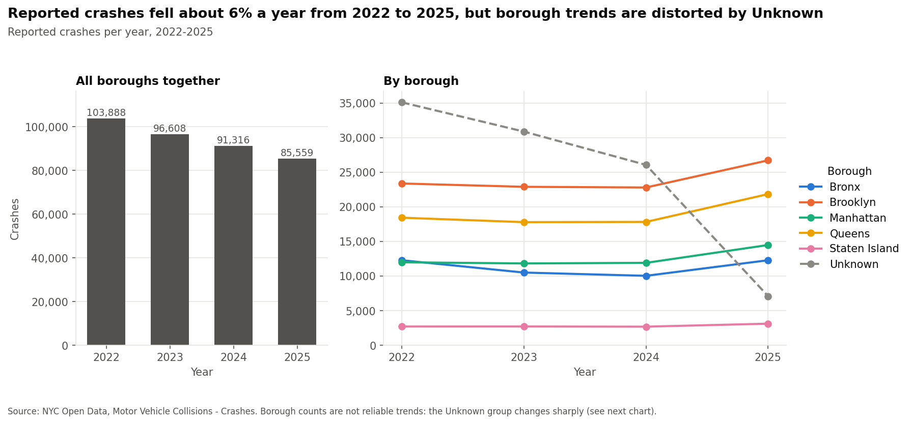
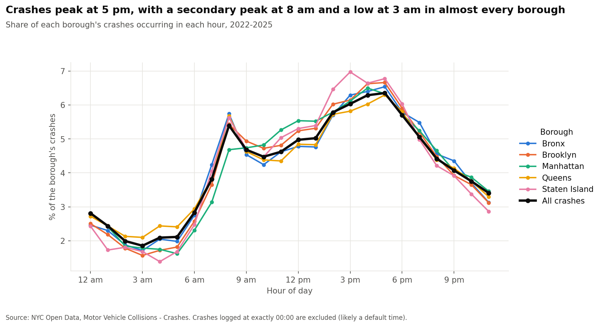
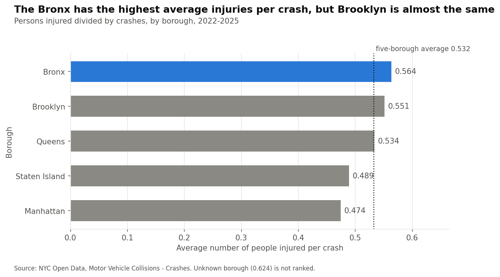
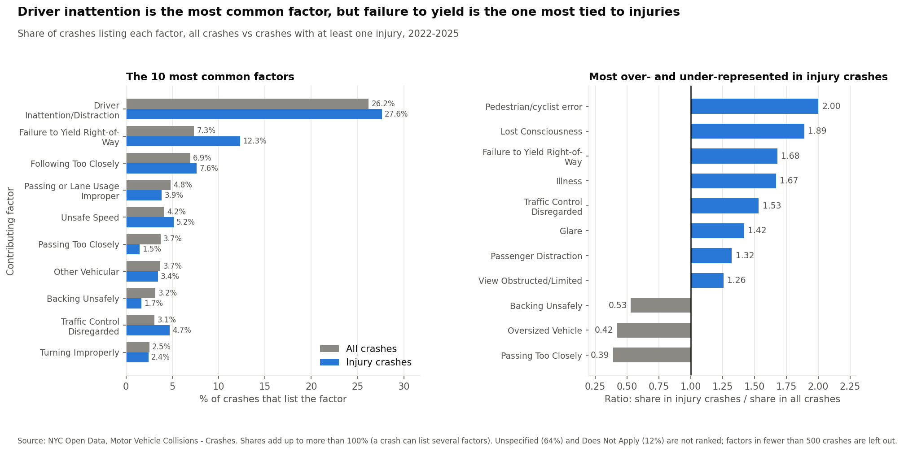
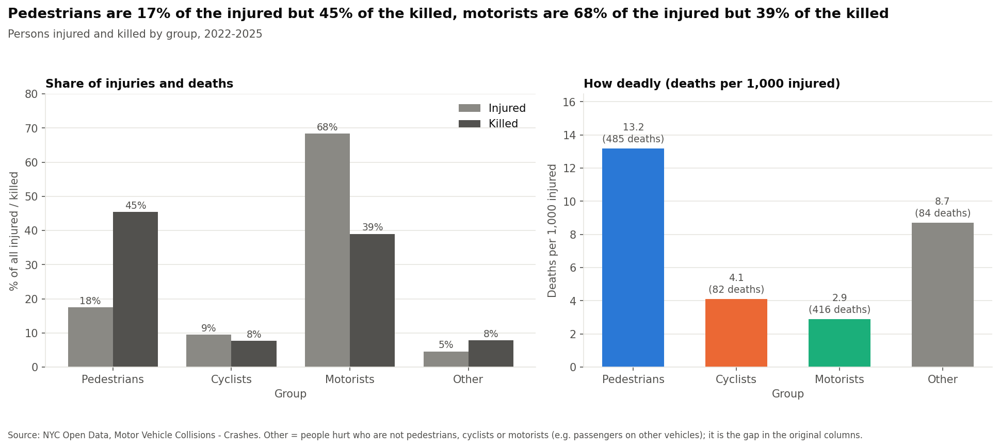
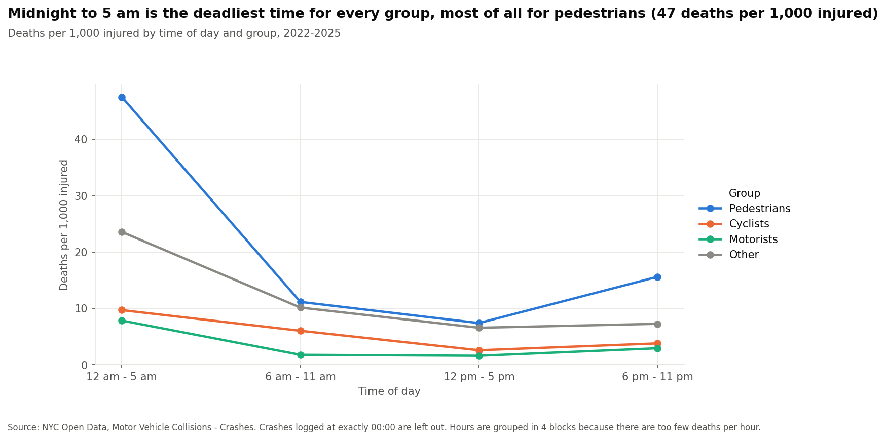
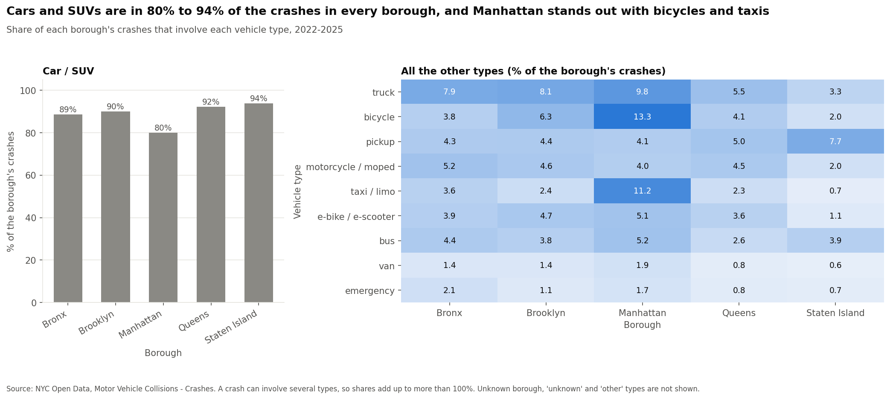
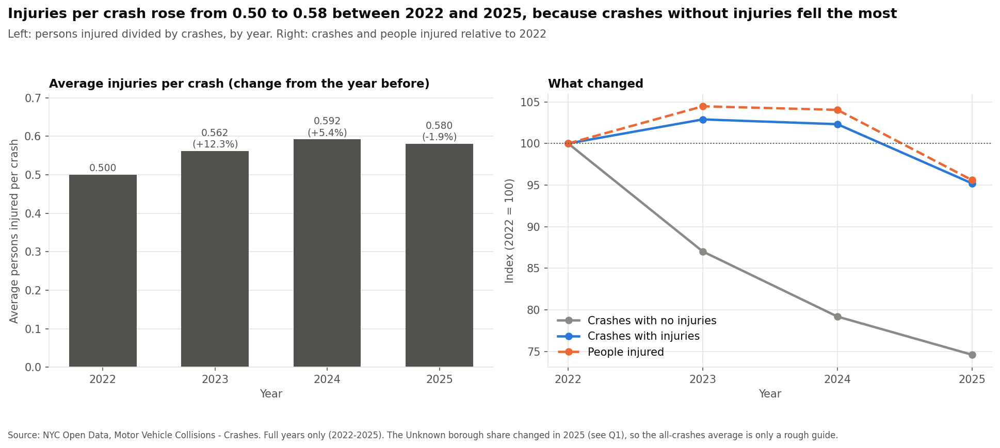

# NYC Motor Vehicle Collisions: 2022-2025 Analysis

I analyzed the NYC Motor Vehicle Collisions - Crashes data (NYPD, published on NYC Open Data) to answer 6 questions about when and where crashes happen, who gets hurt, and what is behind them. I did the cleaning and the analysis in Python (pandas, matplotlib) in two Jupyter notebooks.

**Data:** [Motor Vehicle Collisions - Crashes](https://catalog.data.gov/dataset/motor-vehicle-collisions-crashes). One row is one police-reported crash. The file I downloaded has 449,586 crashes from Jan 1, 2022 to Nov 9, 2026.
**Years analyzed:** 2022 to 2025 (377,371 crashes). 2026 is not a full year, so I left it out of the comparisons.

## What I found

| # | Question | Short answer |
|---|---|---|
| 1 | How do crashes vary by hour, month and year in each borough? | Crashes peak around 5 pm (with a smaller peak at 8 am), are lowest around 3 am, and are highest in May and June. Total crashes fell 17.6% from 2022 to 2025, but I can't say that for each borough (see the data problem below). |
| 2 | Which borough has the highest average injuries per crash? | The Bronx (0.564 injuries per crash), but Brooklyn is almost the same (0.551). |
| 3 | Which contributing factors are most common, and which are over-represented in injury crashes? | Driver Inattention is the most common (26.2% of crashes) but it is not especially linked to injuries. Failure to Yield (ratio 1.68) and Traffic Control Disregarded (1.53) are the most over-represented. |
| 4 | How do injuries and deaths differ among pedestrians, cyclists, motorists and others? | Pedestrians are 17.5% of the injured but 45.5% of the deaths (13.2 deaths per 1,000 injured, against 2.9 for motorists). |
| 5 | Which vehicle types appear most often in each borough? | Cars and SUVs are in 80% to 94% of crashes everywhere. After that it is trucks in the Bronx, Brooklyn and Queens, pickups in Staten Island, and bicycles and taxis in Manhattan. |
| 6 | How has the average injuries per crash changed by year? | It went from 0.500 (2022) to 0.580 (2025), because crashes without injuries fell 25% while crashes with injuries fell only 5%. |

### Q1: crashes by year, month and hour


- Total crashes fell about 6% every year: 103,888 in 2022, 96,608, 91,316 and 85,559 in 2025 (-17.6%).
- **A data problem I had to work around:** the share of crashes with no borough was 33.8% in 2022, 28.5% in 2024 and then dropped to about 3% from May 2025. Because of that, every named borough looks like it went *up* in 2025 (+15.9% to +22.6%), but that is mostly crashes getting a borough, not more crashes. I only trust the total line for year-to-year changes.
- By month (crashes per day, 100 = average month) the highest are May (107.1) and June (106.9) and the lowest are January (91.8) and February (92.9). Manhattan changes the most through the year.
- By hour the peak is 5 pm, and 3 pm to 7 pm holds 24.4% of all crashes. The quietest hour is 3 am.



### Q2: injuries per crash by borough


- Bronx 0.564, Brooklyn 0.551, Queens 0.534, Staten Island 0.489, Manhattan 0.474.
- The gap between the Bronx and Brooklyn is only 0.012. Brooklyn was first in 2022, and the Bronx has been first every year since 2023.
- Unknown borough has the highest average of all (0.624) but I did not rank it, because I can't say where those crashes happened.

### Q3: contributing factors


- 64.4% of crashes list "Unspecified" and 12.4% "Does Not Apply", so I did not rank those two.
- Most over-represented in injury crashes: Failure to Yield Right-of-Way (12.3% of injury crashes vs 7.3% of all crashes), Traffic Control Disregarded (4.7% vs 3.1%) and Unsafe Speed (5.2% vs 4.2%).
- Passing Too Closely goes the other way (1.5% vs 3.7%).
- A high ratio does not mean the factor causes the injuries.

### Q4: pedestrians, cyclists, motorists and others


- 209,857 people were injured and 1,067 killed in 2022-2025.
- Deaths per 1,000 injured: pedestrians 13.2, other 8.7, cyclists 4.1, motorists 2.9.
- The deadliest time is midnight to 5 am for every group: 47.5 deaths per 1,000 injured pedestrians, with 12.3% of the injured but 28.5% of the deaths.
- By factor, Unsafe Speed has the most deaths (188, mostly motorists) while Failure to Yield and Driver Inattention deaths are mostly pedestrians.



### Q5: vehicle types by borough


- Manhattan is the only borough where bicycles (13.3% of its crashes) and taxis (11.2%) are in the top 3.

### Q6: injuries per crash by year


- 0.500 (2022), 0.562 (2023), 0.592 (2024), 0.580 (2025): +12.3%, +5.4% and -1.9% from the year before.
- The share of crashes with at least one injury went from 37.7% to 43.5%, while the people hurt in each injury crash stayed at about 1.33 to 1.35. It does not mean crashes became more violent.

## How I cleaned the data
Everything is in `01_cleaning.ipynb`, with a log of each problem, the decision and the reason. The raw file is never changed, and the cleaned data is saved to `data/clean/collisions_clean.csv`.

- Combined crash date and time into one datetime column and created year, month and hour columns.
- ZIP codes converted from decimals to text, and values outside the NYC range set to missing. Collision IDs checked to be unique (no duplicates).
- The injured and killed totals are higher than pedestrians + cyclists + motorists in 12,404 rows (injured) and 120 rows (killed), so I kept the difference as a fourth group, "other".
- Missing borough (101,344 crashes, 22.5%) labeled "Unknown" instead of deleting those crashes.
- Latitude and longitude outside NYC set to missing (6,338 rows), and placeholder street names fixed.
- Vehicle type labels grouped into about a dozen categories with rules (for example sedan, SUV and station wagon into "car / SUV").
- Created an injury crash flag (at least one person injured) and dropped the redundant `LOCATION` column.
- Found during the analysis: 6,613 crashes in 2022-2025 are logged at exactly 00:00, which looks like a default time, so I left them out of the hourly analysis only. Also fixed a typo in the factor "Illnes".

## Limitations
- The data only has crashes reported to the police, so the minor ones are probably under-counted, and the drop of crashes without injuries in Q6 may come from reporting.
- The borough is missing for a large share of crashes, and the share changed a lot in 2025, so I can't compare boroughs over time.
- Rates compare crashes, not exposure: I don't know how many people walk, ride or drive in each borough or hour.
- More than three quarters of crashes list their contributing factor as "Unspecified" or "Does Not Apply", so Q3 and the factor part of Q4 only describe the crashes with a real factor. A crash with several factors counts in each one.
- Deaths are few for some groups (cyclists, "other", Staten Island), so those rates move a lot. I only show a rate when there are enough deaths.
- Vehicle types are groups I made with rules, so a few labels may be in the wrong group.

## Project files
```
01_cleaning.ipynb        # data issues and cleaning log, saves the clean file
02_analysis.ipynb        # the 6 questions: tables, charts, findings
images/                  # charts used in this README
data/clean/              # cleaned data (not pushed to GitHub)
requirements.txt
```

## How to run it
1. Download the CSV from the [dataset page](https://catalog.data.gov/dataset/motor-vehicle-collisions-crashes) and save it in the project folder as `Motor_Vehicle_Collisions_-_Crashes.csv`. The data is updated often, so numbers can be slightly different if you download it later (mine ends on Nov 9, 2026).
2. In the Terminal:
   ```
   python3 -m venv .venv
   source .venv/bin/activate
   pip install -r requirements.txt
   jupyter lab
   ```
3. Run `01_cleaning.ipynb` first (it creates `data/clean/collisions_clean.csv`) and then `02_analysis.ipynb`.

**Tools:** Python, pandas, NumPy, matplotlib, Jupyter.
